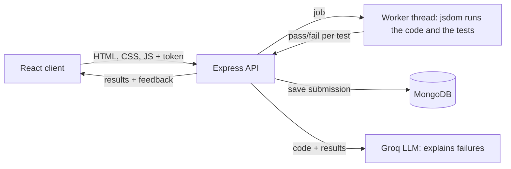

# DeepDev: LeetCode for Web Development

A LeetCode-style platform for practicing frontend development. Pick a challenge, build the UI in an in-browser editor, watch it render live, and submit it. Your code is then **graded by automated tests that run on the server**, and an AI explains any test that fails.

🔗 **Live Demo:** https://deep-dev-seven.vercel.app/
📦 **GitHub Repo:** https://github.com/PriyanshiBisht/deep-dev


## Features

- 🔐 **Authentication:** signup, login and logout with JWT and bcrypt password hashing. The API verifies the token on every protected route, and an expired session sends you back to the login page.
- 🧩 **Challenge library:** 6 interview-style challenges (navbar, accordion, counter, pricing cards, debounced search, modal), each with a difficulty level and topic tags.
- 💻 **In-browser code editor:** Monaco Editor (the engine behind VS Code) with separate HTML, CSS and JS tabs, plus a live preview that updates as you type.
- ✅ **Automated grading:** every challenge has its own tests, run on the server against your code. You get a per-test pass/fail checklist and a score.
- 🤖 **AI feedback:** the tests decide whether your code is correct; the LLM only explains why a failed test failed and suggests fixes.
- 📈 **Progress tracking:** a challenge counts as solved only when **all** its tests pass, and the server makes that decision.
- 🗓️ **Submission activity:** every submission is recorded. The profile shows total submissions, solved problems by difficulty, and a one-year activity calendar with active days and max streak.
- 🔄 **Reset Code and View Solution:** revert to the starter code anytime, or peek at a reference solution (viewing it disables submitting that challenge).
- 👤 **Profile dashboard:** recently solved challenges and profile editing.
- 📱 **Responsive design:** usable on mobile, tablet and desktop.

## How grading works



1. The client sends the submitted code and a login token. The tests are **not** sent by the client, because they live only on the server.
2. The server starts an isolated **worker thread**, which loads the code into [jsdom](https://github.com/jsdom/jsdom) (a headless DOM) and runs the challenge's tests: it clicks buttons, types into inputs, advances a fake clock for timers, and reads the DOM and computed styles.
3. The results come back as a list of `{ name, passed }`. If every test passed, the challenge is marked as solved for the logged-in user.
4. Every submission, passed or failed, is saved. The profile reads these records to build the stats and the calendar.
5. The code and the test results are sent to an LLM (Groq), which explains the failures in plain language.

## Design decisions

- **Tests live on the server.** Students can't read or change what they're graded on, and the client never decides what counts as solved.
- **Behaviour, not source reading.** Tests interact with the page like a user, so any correct solution passes, however it is written.
- **No free passes.** Each test checks the starting state before acting, so empty starter code can't pass behaviour tests. `validate-challenges.js` checks that every starter fails and every solution passes.
- **Untrusted code is isolated.** Grading runs in a worker thread with a memory cap and no access to environment variables.
- **Two time limits.** Loading jsdom is slow on small servers, so the worker gets a generous startup limit, and only the real run (student code plus tests) counts toward the infinite-loop guard.
- **Identity comes from the token, never from the request body.** An auth middleware verifies the JWT and sets the user for each protected route.
- **The LLM is an explainer, not a judge.** Scores come from tests, so they are the same every time.

## Tech stack

**Frontend:** React (Vite), Tailwind CSS, React Router, Monaco Editor (`@monaco-editor/react`)
**Backend:** Node.js, Express, MongoDB + Mongoose, JWT, bcrypt.js, jsdom, Node `worker_threads`, Groq API
**Deployment:** Vercel (frontend), Render (backend)

## API overview

| Method | Route | Auth | Purpose |
|---|---|---|---|
| POST | `/api/auth/signup` | No | Create an account |
| POST | `/api/auth/login` | No | Log in and receive a token |
| PUT | `/api/auth/update` | Yes | Update username or password |
| POST | `/api/grade` | Yes | Run a challenge's tests against submitted code |
| POST | `/api/review` | Yes | Get AI feedback for failed tests |
| GET | `/api/challenges/solved` | Yes | The logged-in user's solved challenge ids |
| GET | `/api/submissions/summary` | Yes | Submission total and per-day counts for the calendar |

## Project structure

```
deep-dev/
├── client/                    # React app (Vite)
│   └── src/
│       ├── dummyChallenges.js # challenge content, starter and solution code
│       ├── api.js             # fetch helper: adds the token, redirects on 401
│       ├── calendarUtils.js   # builds the activity calendar and its stats
│       └── SubmissionCalendar.jsx
└── server/
    ├── server.js              # routes
    ├── challengeTests.js      # server-side tests for each challenge
    ├── grader.js              # jsdom page builder, fake clock, test runner
    ├── gradeWorker.js         # worker-thread entry point
    ├── runGrader.js           # starts the worker and enforces the time limits
    ├── validate-challenges.js # checks every starter fails and every solution passes
    ├── middleware/auth.js     # JWT verification
    └── models/                # User and Submission schemas
```

## Getting started (local setup)

**Prerequisites:** Node.js (developed and deployed on v24.12.0), a MongoDB Atlas connection string, and a Groq API key.

**1. Clone the repo**

```bash
git clone https://github.com/PriyanshiBisht/deep-dev.git
cd deep-dev
```

**2. Backend**

```bash
cd server
npm install
```

Create a `.env` file in `server/`:

```
PORT=5000
MONGO_URI=your_mongodb_connection_string
JWT_SECRET=your_secret_key
GROQ_API_KEY=your_groq_api_key
```

```bash
npm run dev
```

**3. Frontend**

```bash
cd client
npm install
npm run dev
```

The app runs at `http://localhost:5173` and talks to `http://localhost:5000` by default. To point it at a deployed backend, set `VITE_API_URL` (for example in Vercel's environment settings) before building.

## Adding a challenge

1. Add an entry to `client/src/dummyChallenges.js` with an `id`, title, difficulty, tags, a precise description, and the starter and solution code. The description must state everything the tests check.
2. Add its tests to `server/challengeTests.js`, keyed by the same `id`. Test behaviour, and assert the starting state before acting.
3. Run the validator from `server/`:

```bash
node validate-challenges.js
```

Every challenge should show a failing starter and a fully passing solution.

## Known limitations

- jsdom has no layout engine, so layout challenges (navbar, pricing cards) are checked through the CSS values you declare, not through pixel positions.
- Challenge content lives in a static file, not in the database.
- Each submission starts a new worker thread, and there is no job queue or rate limiting yet.
- On the free hosting tier, the first request after a period of inactivity can take up to a minute while the server wakes up.
- The login token is stored in `localStorage`; an HttpOnly cookie would be safer against XSS.

## Roadmap

- Rate limiting on the grading and AI routes
- A job queue with a pool of reusable grading workers
- Automated tests and CI for the API and the grader
- Playwright-based checks for real layout and visual results
- Store challenges and their tests in MongoDB
- Submission history list with the submitted code, and an acceptance rate
- Search and filter challenges by difficulty and tags
- AI-powered hints that nudge without giving the full solution
- More challenges, including pure-JavaScript utility challenges

Built as a personal project to practice and showcase full-stack development skills.
